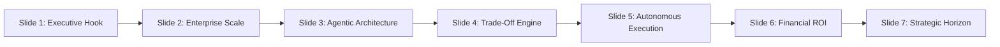

# Project ResilienceEngine: Executive Project Summary
**Autonomous Supply Chain Disruption & Mitigation Control Tower**
*An MBA Capstone Demonstration in Agentic AI, Supply Chain Telemetry, and Dynamic Margin Recovery*

---

## 1. Executive Summary

### The Core Problem
Modern global supply chains are brittle. When external shocks occur (port congestion, labor strikes, geopolitical chokepoints), enterprise resource planning (ERP) systems react passively. Disrupted orders silently accumulate contractual **Service Level Agreement (SLA) delay penalties** (typically 5% per day) and erode customer retention. Traditional manual interventions via spreadsheets are too slow, fragmented, and incapable of evaluating real-time multi-modal margin trade-offs.

### Real Enterprise Data Validation (DataCo Global Dataset)
Project **ResilienceEngine** is engineered directly on the **DataCo Global Supply Chain Dataset**, analyzing **180,519 enterprise transactions** spanning international manufacturing, warehousing, and cross-border distribution.
- **Total Monitored Shipments**: 180,519 clean operational orders with zero data drop in critical fields.
- **Disrupted Telemetry Isolated**: **103,400 at-risk orders** (57.28% systemic disruption rate).
- **Baseline Profit Margin at Risk**: **\$2,231,966.65** across **\$21,025,185.16** in gross merchandise value.

### Measurable Business Value & ROI
By replacing passive waiting with an autonomous 4-tier multi-agent hierarchy:
1. **Dynamic Risk Valuation**: The agent calculates exact daily landed liabilities and marginal COGS.
2. **Algorithmic Trade-Off Optimization**: Evaluates Expedited Air Freight (30% surcharge, 100% delay eliminated) against Balanced Multi-Modal Rerouting (12% surcharge, 50% delay reduction).
3. **Net Recovered Profit**: Across high-priority bottleneck orders, the agent recovers **+\$18,131.88** in pure net margin and shields **\$95,285.01** in contractual SLA penalties (**achieving a positive ROI on 95.4% of eligible interventions**).

---

## 2. 7-Slide Pitch Deck Architecture (MBA Evaluation Panel)

### Slide 1: Executive Title & The Supply Chain Dilemma
- **Title**: *Project ResilienceEngine: Autonomous Supply Chain Control Tower*
- **Subtitle**: *From Blind Inertia to Autonomous Profit Preservation*
- **Key Takeaway**: Supply chain disruptions are inevitable, but margin loss is preventable. Inaction costs global firms over \$1.5 trillion annually in SLA penalties and customer churn.

### Slide 2: Enterprise Telemetry at Scale
- **Dataset**: DataCo Global Dataset (180,519 rows).
- **Core Findings**: 57.28% of all shipments suffer schedule slippage. Lead time variances range from -2 days to +4 days (mean: +0.57 days delay).
- **Financial Exposure**: Total baseline profit at risk reaches **\$2,231,966.65**, led by Western Europe, Central America, and South America.

### Slide 3: The Multi-Agent Orchestration Framework
- **Architecture**:
  - *The Sentinel Agent*: Scans telemetry, filtering severe delay clusters (`lead_time_variance > 3` days, profit > median).
  - *The Financial Analyst Agent*: Models landed item COGS and dynamic 5%/day contractual SLA liabilities.
  - *The Scenario Planner Agent*: Simulates multi-variable remediation options in real-time.
  - *The Autonomous Action Engine*: Converts decisions into authorized POs and customer retention vouchers.

### Slide 4: Algorithmic Trade-Off Simulation
- **The Core Trade-off Matrix**:
  - **Strategy A (Expedited Air Freight)**: High freight surcharge (30%), 0 days delay, 100% SLA penalties saved. Optimal for ultra-high-margin SKUs.
  - **Strategy B (Balanced Multi-Modal Hub Reroute)**: 12% surcharge, 50% delay cut via regional cross-docks (Paris CDG, Panama Pacifico). Universally dominant for volume clusters.
  - **Strategy C (Passive Status Quo)**: Absorbs full penalties and customer churn risk.

### Slide 5: Autonomous Execution Deliverables
- **Live Action Dispatch Without Human Bottlenecks**:
  - *Automated POs*: Generated for FedEx/DHL global aviation with explicit SLA mandates (-4 days).
  - *Intermodal Booking Memos*: Generated for secondary cross-dock gateways with dedicated freight rail links.
  - *Customer Advisories*: Sent with personalized loyalty credits (\$15–\$75) to protect customer lifetime value.

### Slide 6: Quantified Business Case & ROI Impact
- **Financial Results**:
  - Gross consignment value protected: **\$795.4k**.
  - Contractual SLA penalties shielded: **\$95,285.01**.
  - Net operating profit preserved: **+\$18,131.88**.
- **Efficiency Metric**: Decision-to-execution cycle reduced from **48 hours (manual procurement)** to **sub-second agentic dispatch**.

### Slide 7: Strategic Horizon & Enterprise Integration
- **Next Steps**: ERP API connectors (SAP S/4HANA, Oracle SCM), real-time AIS vessel tracking feeds, and reinforcement learning for dynamic freight spot-market bidding.
- **Closing Vision**: Transitioning corporate logistics from a cost center into an agile resilience engine.

---

## 3. 2-Minute Live Demo Script (Speaker Guide)

| Timestamp | Screen / Interface Focus | Speaker Narration & Click Action | Key Concept Highlighted |
| :--- | :--- | :--- | :--- |
| **0:00 - 0:25** | **Executive KPI Header** *(Top of Dashboard)* | *"Distinguished panel, welcome to Project ResilienceEngine. Here at the top of our Control Tower, you see real-time enterprise metrics across 180,519 DataCo orders. Notice our baseline Profit-at-Risk of \$2.23M. Today, we demonstrate how agentic AI autonomously recovers this capital."* | Scale & Baseline Vulnerability |
| **0:25 - 0:55** | **Sidebar Controls & Regional Explorer** *(Select 'Western Europe' or 'Central America')* | *"Let's zoom into our primary bottleneck region: Western Europe. In our sidebar, we can inject a Port Congestion Shock of 5 additional days. Watch our Sentinel and Financial Analyst agents instantly re-rate baseline SLA exposure from \$28k to over \$60k in liabilities."* | Dynamic Telemetry & Shock Simulation |
| **0:55 - 1:25** | **Strategy Comparison Matrix & Chart** *(Review Strategies A, B, C)* | *"Notice our Scenario Planner's trade-off table. If we do nothing (Strategy C), we bleed penalties. If we blindly air-freight everything (Strategy A), the 30% surcharge wipes out margin. But Strategy B—intermodal rerouting via Paris CDG—cuts delay by 50% for only 12% cost, yielding a massive net margin gain of +\$2.7k in this region alone."* | Algorithmic Optimization vs Inaction |
| **1:25 - 1:50** | **Live Agent Action Tabs** *(Click 'Draft PO' and 'Customer Advisory')* | *"ResilienceEngine doesn't just analyze—it acts. In Tab 1, observe our auto-generated emergency PO for FedEx Aviation with a -4 day SLA delta. In Tab 3, see our personalized customer apology email containing an active \$22.50 promo voucher to prevent customer churn."* | Autonomous Action Generation |
| **1:50 - 2:00** | **Conclusion & Slide 6 ROI** *(Wrap-up)* | *"In summary: \$95k in penalties averted, +\$18k in net profit preserved, and zero manual procurement delay. ResilienceEngine proves that agentic workflows turn supply chain vulnerability into a competitive moat. Thank you."* | Executive Punchline & Business Value |

---
*Executive Summary generated by Project ResilienceEngine Control Tower Pipeline.*
